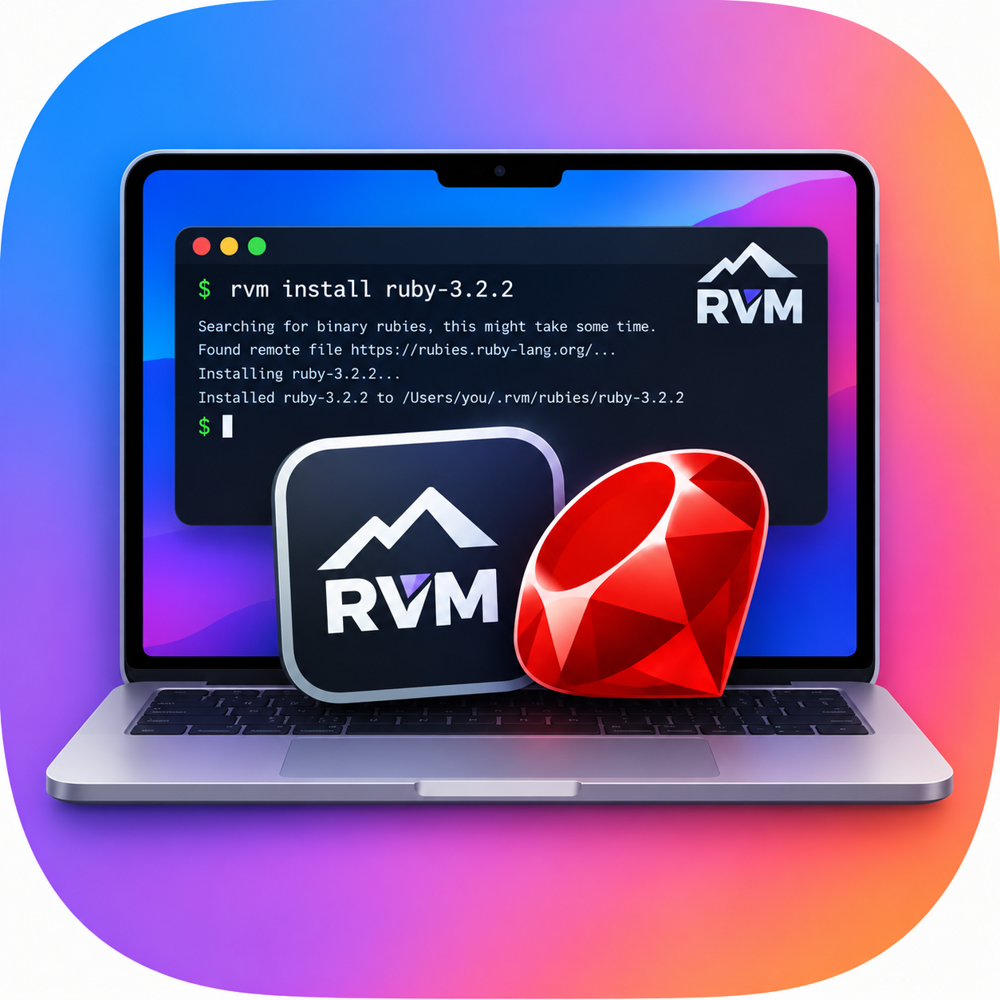

# ruby-macos-compat-install

[English](#english) | [中文](#中文)

<a id="english"></a>

## English

Install **any Ruby version with RVM on macOS** — on both Apple Silicon (M-series, arm64) and Intel (x86_64) Macs — handling the known compatibility gaps automatically.

- For **Ruby <= 2.7.1 on arm64**: applies the bundled Apple Silicon patch (`configure` `__arm64__` branch + fiddle legacy closure API fix).
- For **Ruby < 3.1**: resolves OpenSSL 1.1, building 1.1.1w from source when Homebrew no longer provides the EOL formula.



### When to use

- Installing any Ruby version with RVM on a Mac, especially legacy versions.
- `rvm install <version>` fails on an arm64 Mac.
- The build log shows `ffi_prep_closure` / `-Wimplicit-function-declaration` in `ext/fiddle`, or `ERR_get_error_line_data is deprecated` in `ext/openssl`.
- `rvm list` shows the ruby as `[ broken ]`, or `ruby -v` prints `[-darwin25]` (empty CPU) instead of `[arm64-darwin25]`.

### Compatibility matrix

| Ruby version | Apple Silicon (arm64) | Intel (x86_64) |
|---|---|---|
| <= 2.7.1 (incl. 2.3.x – 2.6.x) | bundled patch + OpenSSL 1.1 | OpenSSL 1.1 |
| 2.7.2 – 3.0.x | OpenSSL 1.1 | OpenSSL 1.1 |
| >= 3.1 | nothing special | nothing special |

### Quick start

```bash
scripts/install_ruby.sh <version>            # e.g. 2.6.5, 2.7.1, 3.3.8
scripts/install_ruby.sh <version> --dry-run  # print the plan, build nothing
scripts/install_ruby.sh <version> --bg       # detached, poll the printed log
```

The script decides automatically what is needed:

1. **Normal build preferred** — a clean PATH plus `PKG_CONFIG_PATH` pinned to OpenSSL 1.1 for Ruby < 3.1.
2. **arm64 + Ruby <= 2.7.1** — a stock build can never succeed, so the bundled patch is applied directly.
3. **OpenSSL 1.1 resolution** — existing Homebrew install → previous source build → `brew install openssl@1.1` → build 1.1.1w from the official openssl.org tarball (sha256-verified).
4. **Verification** — arch, OpenSSL, fiddle closures.

A full build takes roughly 6–10 minutes. Pass exact `X.Y.Z` versions (`2.7.1`, not `2.7`).

### Install as an AI coding skill

This repo is packaged as a [Claude Code](https://docs.claude.com/en/docs/claude-code) / [CodeBuddy](https://cnb.cool/codebuddy/codebuddy-code) skill. Clone it into the skills directory of your AI tool:

```bash
# Claude Code
git clone https://github.com/ScottZg/ruby-macos-compat-install.git \
  ~/.claude/skills/ruby-macos-compat-install

# CodeBuddy Code
git clone https://github.com/ScottZg/ruby-macos-compat-install.git \
  ~/.codebuddy/skills/ruby-macos-compat-install
```

Then just ask your AI assistant in natural language, for example:

> 帮我用 rvm 安装 ruby 2.6.5 / Install ruby 2.6.5 with rvm

The skill triggers automatically when the request matches installing Ruby with RVM on a Mac, or when `rvm install` fails with the signatures above — no manual invocation needed. The AI will read `SKILL.md`, run `scripts/install_ruby.sh`, and verify the result.

To update later: `git -C ~/.claude/skills/ruby-macos-compat-install pull` (or the CodeBuddy path).

### Requirements

- RVM (`~/.rvm/bin/rvm`)
- Xcode command line tools with an SDK matching the running macOS
- OpenSSL 1.1 for Ruby < 3.1 (resolved/built automatically by the script)

See [SKILL.md](SKILL.md) for the manual path, patch regeneration, and [references/troubleshooting.md](references/troubleshooting.md) for error signatures and log-reading guidance.

### License

MIT — see [LICENSE](LICENSE).

---

<a id="中文"></a>

## 中文

在 macOS 上用 RVM 安装**任意版本的 Ruby**——同时支持 Apple Silicon（M 系列, arm64）和 Intel（x86_64）Mac——自动处理已知的兼容性问题。

- **arm64 上的 Ruby <= 2.7.1**：自动应用内置的 Apple Silicon 补丁（`configure` 的 `__arm64__` 分支 + fiddle 旧版 closure API 修复）。
- **Ruby < 3.1**：自动解决 OpenSSL 1.1 依赖，在 Homebrew 已下架该 EOL 版本时从源码构建 1.1.1w。


### 适用场景

- 在 Mac 上用 RVM 安装任意 Ruby 版本，尤其是老版本。
- `rvm install <version>` 在 arm64 Mac 上失败。
- 构建日志出现 `ffi_prep_closure` / `-Wimplicit-function-declaration`（ext/fiddle），或 `ERR_get_error_line_data is deprecated`（ext/openssl）。
- `rvm list` 显示 `[ broken ]`，或 `ruby -v` 输出 `[-darwin25]`（CPU 为空）而非 `[arm64-darwin25]`。

### 兼容性矩阵

| Ruby 版本 | Apple Silicon (arm64) | Intel (x86_64) |
|---|---|---|
| <= 2.7.1（含 2.3.x – 2.6.x） | 内置补丁 + OpenSSL 1.1 | OpenSSL 1.1 |
| 2.7.2 – 3.0.x | OpenSSL 1.1 | OpenSSL 1.1 |
| >= 3.1 | 无需特殊处理 | 无需特殊处理 |

### 快速开始

```bash
scripts/install_ruby.sh <版本>            # 如 2.6.5、2.7.1、3.3.8
scripts/install_ruby.sh <版本> --dry-run  # 只打印计划，不构建
scripts/install_ruby.sh <版本> --bg       # 后台构建，轮询打印的日志
```

脚本会自动判断所需的处理：

1. **优先走正常构建**——干净的 PATH（IDE 注入的 `rm` shim 会破坏 autoconf），Ruby < 3.1 时把 `PKG_CONFIG_PATH` 固定到 OpenSSL 1.1。
2. **arm64 + Ruby <= 2.7.1**——原生构建必然失败，直接带内置补丁构建。
3. **OpenSSL 1.1 解析**——已有 Homebrew 安装 → 之前的源码构建 → `brew install openssl@1.1` → 从 openssl.org 官方源码包（校验 sha256）构建 1.1.1w。
4. **验证**——arch、OpenSSL、fiddle closure。

完整构建约需 6–10 分钟。请传精确的 `X.Y.Z` 版本号（`2.7.1`，而不是 `2.7`）。

### 作为 AI 编码工具的 skill 安装使用

本仓库打包为 [Claude Code](https://docs.claude.com/en/docs/claude-code) / [CodeBuddy](https://cnb.cool/codebuddy/codebuddy-code) 的 skill，克隆到 AI 工具的 skills 目录即可：

```bash
# Claude Code
git clone https://github.com/ScottZg/ruby-macos-compat-install.git \
  ~/.claude/skills/ruby-macos-compat-install

# CodeBuddy Code
git clone https://github.com/ScottZg/ruby-macos-compat-install.git \
  ~/.codebuddy/skills/ruby-macos-compat-install
```

之后直接用自然语言对 AI 助手提需求即可，例如：

> 帮我用 rvm 安装 ruby 2.6.5 / Install ruby 2.6.5 with rvm

当请求匹配「在 Mac 上用 RVM 安装 Ruby」，或 `rvm install` 出现上文提到的错误签名时，skill 会被自动触发，无需手动调用。AI 会读取 `SKILL.md`，执行 `scripts/install_ruby.sh` 并验证结果。

后续更新：`git -C ~/.claude/skills/ruby-macos-compat-install pull`（CodeBuddy 同理换路径）。

### 环境要求

- RVM（`~/.rvm/bin/rvm`）
- Xcode command line tools（SDK 与当前 macOS 匹配）
- Ruby < 3.1 需要的 OpenSSL 1.1（脚本自动解析/构建）

手动安装路径、补丁再生成方法见 [SKILL.md](SKILL.md)；错误签名与日志排查见 [references/troubleshooting.md](references/troubleshooting.md)。

### 许可证

MIT——详见 [LICENSE](LICENSE)。
